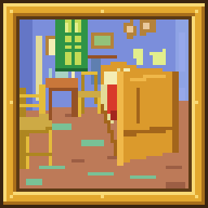
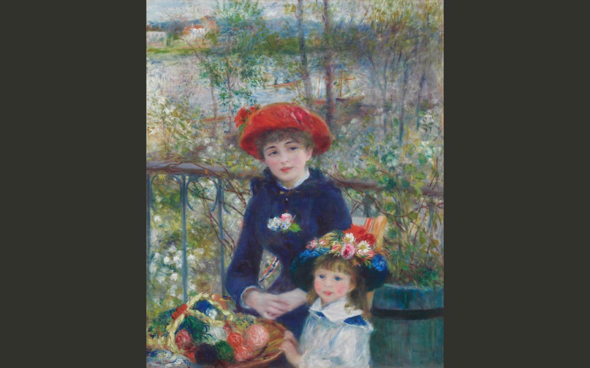

<!-- markdownlint-disable MD033 MD041 -->
<!-- docs/README.zh-CN.md mirrors this file block for block; change both together. -->
<p align="center"><b>English</b> | <a href="docs/README.zh-CN.md">简体中文</a></p>

<p align="center"></p>

<h1 align="center">Paintpane</h1>

<p align="center">Museum masterpieces on your desktop.</p>

<p align="center"><a href="https://github.com/begineri/Paintpane/releases/latest/download/paintpane.exe"><b>Download for Windows</b></a> · <a href="https://begineri.github.io/Paintpane/">Website</a></p>

<p align="center"><br><sub>Two Sisters (On the Terrace) — Pierre-Auguste Renoir · Art Institute of Chicago</sub></p>

Turns your Windows wallpaper into museum paintings, to enjoy any time and choose as you like.

- **Lives in the tray, changes on a schedule.** Works come from the open-access collections of The Metropolitan Museum of Art, the Art Institute of Chicago, the Cleveland Museum of Art, the Rijksmuseum, the National Palace Museum, Statens Museum for Kunst and the J. Paul Getty Museum. The first line of the tray menu names the work, the artist and the museum.
- **Shown whole, never cropped.** Full artwork fits the entire painting on your screen. Nothing is cropped, and nothing is drawn over the picture.
- **Or use your own pictures.** Pictures from the wallpaper site wallhaven, the free photo library Pexels or Wikipedia's media library Wikimedia Commons, or a folder on your PC.

**Download:** `paintpane.exe` from [Releases](https://github.com/begineri/Paintpane/releases/latest).

Unofficial fork of [Spice](https://github.com/dixieflatline76/Spice) by Karl Kwong · PolyForm Noncommercial License 1.0.0

## What it does

Paintpane cycles wallpapers from open-access museum collections (The Metropolitan Museum of Art, the Art Institute of Chicago, the Cleveland Museum of Art, the Rijksmuseum, the National Palace Museum, Statens Museum for Kunst, the J. Paul Getty Museum), Wikimedia Commons, wallhaven, Pexels, local folders and your favorites. A new installation starts with only the museum collections and Favorites turned on; the other sources are off until you turn them on in Settings › Sources. It runs in the Windows system tray and supports global hotkeys. It handles each monitor independently. All of that comes from Spice; see [What's different from Spice](#whats-different-from-spice) for what Paintpane adds.

## Download

Get `paintpane.exe` from the [latest release](https://github.com/begineri/Paintpane/releases/latest). It is a single portable file: no installer needed.

- **Windows 10 / 11, 64-bit.** macOS builds are not provided.
- **Windows SmartScreen warning:** the build is not code-signed, so Windows may say it "protected your PC". Choose **More info → Run anyway**. You can check the file against the SHA-256 published with each release.
- **Settings are separate from Spice.** Paintpane keeps its own settings and cache, so it will not touch an installed copy of Spice. Do not run both at the same time: both would change your wallpaper.

## What's different from Spice

- **Paintings shown whole.** The default mode, **Full artwork**, fits the whole painting on a wall-colour background; **Museum frame** hangs it in a gallery frame. Spice's cropping is still there as **Smart crop**. Switch in one click from the tray.
- **Tune image** in the tray adjusts just the picture on screen: drag to choose the part that is kept, or pick a different mode for this picture alone.
- **NSFW images are hidden by default**, including curated collections of nudes and anything you mark with **Mark as NSFW**. **Don't show this image again** skips a picture from then on.
- **The Windows lock screen gets a painting too.** **Next lock screen picture** in the tray changes only the lock screen.
- **Redesigned settings and tray menu.** One settings window with light and dark appearance and accent colours; a shorter tray menu with the work and artist on top. New icon: Van Gogh's *The Bedroom* in a gold frame.
- **Quieter and lighter.** Starts with Windows and waits a minute or two before going online, shows no Windows notifications, and caps originals at about 4K to save disk space.
- **More reliable.** Memory use is kept in check, the image cache stays within its limit, and failed downloads are retried.
- **No browser extension.** The Chrome and Firefox extensions belong to the Spice project and are not tested with Paintpane.

## Build from source

Requires Go 1.27 (the version CI and release builds use) and a MinGW-w64 C compiler (for Fyne/OpenGL).

```bash
go test ./...
go build -tags release -o bin/paintpane.exe -ldflags "-s -w -H=windowsgui -X main.version=$(cat version.txt)" ./cmd/spice
```

The Go module path is still `github.com/dixieflatline76/Spice/v2`, kept on purpose so the code stays easy to compare with Spice.

The website is plain HTML and CSS in [`site/`](site/); open `site/index.html` in a browser to preview it.

## Contributing

Ideas and bug reports are welcome in [Issues](https://github.com/begineri/Paintpane/issues). Please report Paintpane problems here, not to the Spice project. If you would like to contribute code, see [CONTRIBUTING.md](.github/CONTRIBUTING.md).

## Credits

Paintpane is built on [Spice](https://github.com/dixieflatline76/Spice), created by Karl Kwong. Nearly all of the application is his work. Paintpane was called MuseWall while it was in development. Artwork comes from the open-access programmes of the museums listed above.

## License

Paintpane is distributed under the same [PolyForm Noncommercial License 1.0.0](LICENSE) as Spice, with Karl Kwong's copyright notice kept. **Noncommercial use only**: you may use, study, modify and share it, but not for commercial advantage or monetary compensation. See [NOTICE.md](NOTICE.md).
