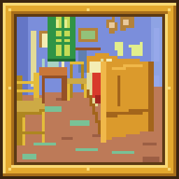
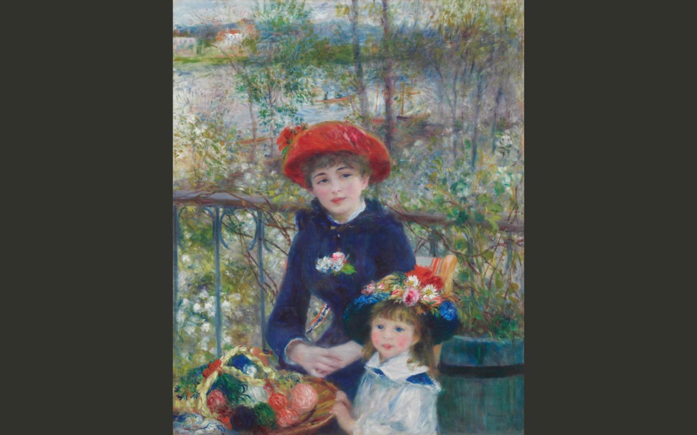

<!-- markdownlint-disable MD033 MD041 -->
<!-- Chinese README, mirrors README.md block for block; change both together. -->
<p align="center"><a href="README.md">English</a> | <b>简体中文</b></p>

<p align="center"></p>

<h1 align="center">观画壁纸（Paintpane）</h1>

<p align="center">博物馆名作，就在你的桌面上。</p>

<p align="center"><a href="https://github.com/begineri/Paintpane/releases/latest/download/paintpane.exe"><b>下载 Windows 版</b></a> · <a href="https://begineri.github.io/Paintpane/zh/">介绍页</a></p>

<p align="center"><br><sub>《两姐妹（在露台上）》— 皮埃尔-奥古斯特·雷诺阿 · 芝加哥艺术博物馆</sub></p>

把你的 Windows 壁纸换成博物馆里的名画，随时欣赏，自由选择。

- **常驻托盘，定时换一幅**：作品来自大都会艺术博物馆、芝加哥艺术博物馆、克利夫兰艺术博物馆、荷兰国立博物馆、台北故宫博物院、丹麦国家美术馆和盖蒂博物馆的开放馆藏；托盘菜单第一行就是作品、画家和博物馆。
- **整幅显示，不裁切**：“完整显示”把整幅画放进屏幕，不裁切，画面上也不叠加任何东西。
- **也可以用你自己的图**：壁纸网站 wallhaven、免费图库 Pexels、维基共享资源（维基百科的图片库）上的图，或者你电脑里的一个文件夹。

**下载**：在[发布页](https://github.com/begineri/Paintpane/releases/latest)下载 `paintpane.exe`。

基于 Karl Kwong 的 [Spice](https://github.com/dixieflatline76/Spice) 的非官方修改版 · PolyForm Noncommercial License 1.0.0

## 功能

观画壁纸定时更换壁纸，图源包括多家博物馆的开放馆藏（大都会艺术博物馆、芝加哥艺术博物馆、克利夫兰艺术博物馆、荷兰国立博物馆、台北故宫博物院、丹麦国家美术馆、盖蒂博物馆）、维基共享资源、wallhaven、Pexels、本地文件夹和收藏夹。新安装时只开着博物馆馆藏和收藏夹，其他图源要在“设置 › 图源”里打开。它常驻 Windows 托盘，支持全局快捷键。每台显示器独立轮换。以上能力都来自 Spice，观画壁纸在此基础上做的改动见[相比 Spice 的改动](#相比-spice-的改动)。

## 下载

在[最新版本](https://github.com/begineri/Paintpane/releases/latest)下载 `paintpane.exe`，单个文件，免安装，直接运行。

- **Windows 10 / 11，64 位。** 不提供 macOS 版。
- **SmartScreen 提示**：程序没有代码签名，Windows 可能提示“已保护你的电脑”，点**更多信息 → 仍要运行**。每个版本都附有 SHA-256，可以自行校验。
- **设置与 Spice 互不影响**：观画壁纸使用独立的设置和缓存目录，不会改动已安装的 Spice。不要和 Spice 同时运行，两者都会更换壁纸。

## 相比 Spice 的改动

- **整幅显示名画**：默认的**完整显示**把整幅画放进屏幕，空白处用墙面颜色补齐；**博物馆画框**把画装进画框。Spice 原来的裁切方式保留为**智能裁切**。在托盘里一键切换。
- 托盘里的**调整此图**只改屏幕上这一张：拖动选要保留的部分，或者只给这一张换一种显示方式。
- **默认隐藏 NSFW 图片**，包括裸体主题的馆藏合集和你用**标记为 NSFW** 标记的图片。**不再显示此图**以后都会跳过这一张。
- **Windows 锁屏也换成名画**。托盘里的**锁屏换一张**只换锁屏。
- **重新设计的设置和托盘菜单**：设置集中在一个窗口里，支持浅色、深色外观和主题色；托盘菜单更精简，最上面是作品和画家。新图标是金色画框里的梵高《卧室》。
- **更安静，占用更少**：随 Windows 启动，登录后等一两分钟再联网；不弹 Windows 通知；原图默认缩到约 4K，节省磁盘。
- **更稳定**：控制内存占用，图片缓存不超出上限，下载失败自动重试。
- **没有浏览器扩展**：Chrome / Firefox 商店里的扩展属于 Spice 项目，未在观画壁纸上测试。

## 从源码构建

需要 Go 1.27（CI 和正式版构建用的版本）和 MinGW-w64 C 编译器（Fyne/OpenGL 需要）。

```bash
go test ./...
go build -tags release -o bin/paintpane.exe -ldflags "-s -w -H=windowsgui -X main.version=$(cat version.txt)" ./cmd/spice
```

Go 模块路径仍是 `github.com/dixieflatline76/Spice/v2`，有意保留，方便和 Spice 的代码对照。

介绍页是 [`site/`](site/) 里的纯 HTML 和 CSS，用浏览器打开 `site/zh/index.html` 即可预览。

## 参与贡献

欢迎在 [Issues](https://github.com/begineri/Paintpane/issues) 提建议、报 bug。观画壁纸的问题请报到这里，不要报给 Spice 项目。想提交代码，请看 [CONTRIBUTING.md](CONTRIBUTING.md)。

## 致谢

观画壁纸基于 Karl Kwong 创建的 [Spice](https://github.com/dixieflatline76/Spice)，应用的绝大部分是他的作品。观画壁纸在开发期间名为 MuseWall。画作来自上面列出的各博物馆的开放获取项目。

## 许可证

与 Spice 相同，使用 [PolyForm Noncommercial License 1.0.0](LICENSE)，并保留 Karl Kwong 的版权声明。**仅限非商业用途**：可以使用、修改、分享，但不能用于商业目的或获取报酬。详见 [NOTICE.md](NOTICE.md)。
