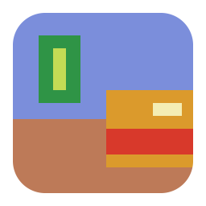
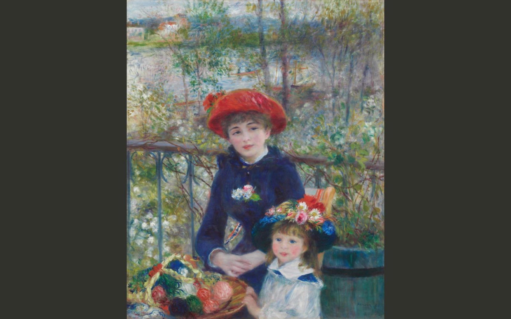

<!-- markdownlint-disable MD033 MD041 -->
<!-- Chinese README, mirrors README.md block for block; change both together. -->
<p align="center"><a href="../README.md">English</a> | <b>简体中文</b></p>

<p align="center"></p>

<h1 align="center">观画壁纸（Paintpane）</h1>

<p align="center">博物馆名作，就在你的桌面上。</p>

<p align="center"><a href="https://apps.microsoft.com/detail/9PM9S0JCPJTX?referrer=appbadge&amp;mode=full"><picture><source media="(prefers-color-scheme: dark)" srcset="https://get.microsoft.com/images/zh-cn%20light.svg"></picture></a></p>

<p align="center"><a href="https://github.com/begineri/Paintpane/releases/latest"></a>
  <a href="../LICENSE"></a>
  <a href="https://begineri.github.io/Paintpane/zh/privacy.html"></a></p>

<p align="center">也可以直接下载 <a href="https://github.com/begineri/Paintpane/releases/latest/download/paintpane.exe"><b>paintpane.exe</b></a>（免安装）· <a href="https://begineri.github.io/Paintpane/zh/">介绍页</a></p>

<p align="center"><br><sub>《两姐妹（在露台上）》— 皮埃尔-奥古斯特·雷诺阿 · 芝加哥艺术博物馆</sub></p>

观画壁纸是一款免费的 Windows 10 / 11 壁纸软件。它把博物馆开放馆藏里的名画设成你的桌面壁纸，整幅显示、不裁切，并定时换一幅。

- **常驻托盘，定时换一幅**：作品来自大都会艺术博物馆、芝加哥艺术博物馆、克利夫兰艺术博物馆、荷兰国立博物馆、台北故宫博物院、丹麦国家美术馆、盖蒂博物馆、美国国家美术馆、耶鲁大学艺术馆藏和巴黎市立博物馆联盟的开放馆藏；托盘菜单第一行就是作品、画家和博物馆。
- **整幅显示，不裁切**：“完整显示”把整幅画放进屏幕，不裁切，画面上也不叠加任何东西。
- **也可以用你自己的图**：壁纸网站 wallhaven、免费图库 Pexels、维基共享资源（维基百科的图片库）上的图，或者你电脑里的一个文件夹。

**下载**：在[发布页](https://github.com/begineri/Paintpane/releases/latest)下载 `paintpane.exe`。

基于 Karl Kwong 的 [Spice](https://github.com/dixieflatline76/Spice) 的非官方修改版 · PolyForm Noncommercial License 1.0.0

## 功能

观画壁纸定时更换壁纸，图源包括多家博物馆的开放馆藏（大都会艺术博物馆、芝加哥艺术博物馆、克利夫兰艺术博物馆、荷兰国立博物馆、台北故宫博物院、丹麦国家美术馆、盖蒂博物馆、美国国家美术馆、耶鲁大学艺术馆藏、巴黎市立博物馆联盟）、维基共享资源、wallhaven、Pexels、本地文件夹和收藏夹。新安装时只开着博物馆馆藏和收藏夹，其他图源要在“设置 › 图源”里打开。它常驻 Windows 托盘，支持全局快捷键。每台显示器独立轮换。以上能力都来自 Spice，观画壁纸在此基础上做的改动见[相比 Spice 的改动](#相比-spice-的改动)。

## 下载

在[最新版本](https://github.com/begineri/Paintpane/releases/latest)下载 `paintpane.exe`，单个文件，免安装，直接运行。

也可以从 [Microsoft Store](https://apps.microsoft.com/detail/9PM9S0JCPJTX) 安装，由商店安装和更新，设置和便携版分开保存。

- **Windows 10 / 11，64 位。** 不提供 macOS 版。
- **SmartScreen 提示**：程序没有代码签名，Windows 可能提示“已保护你的电脑”，点**更多信息 → 仍要运行**。每个版本都附有 SHA-256，可以自行校验。
- **设置与 Spice 互不影响**：观画壁纸使用独立的设置和缓存目录，不会改动已安装的 Spice。不要和 Spice 同时运行，两者都会更换壁纸。

## 相比 Spice 的改动

- **默认整幅显示名画**，也可以加博物馆画框。Spice 原来的裁切保留为**智能裁切**，**调整此图**可以单独调整一张。
- **多了三家博物馆**：美国国家美术馆、耶鲁大学艺术馆藏和巴黎市立博物馆联盟。
- **默认隐藏 NSFW 图片**。
- **Windows 锁屏也换成名画**。
- **界面重新设计，也更安静**：新的设置窗口和托盘菜单，随 Windows 启动，不弹通知，占用更少磁盘和内存。
- **没有浏览器扩展**：Chrome / Firefox 商店里的扩展属于 Spice 项目，未在观画壁纸上测试。

## 从源码构建

需要 Go 1.27（CI 和正式版构建用的版本）和 MinGW-w64 C 编译器（Fyne/OpenGL 需要）。

```bash
go test ./...
go build -tags release -o bin/paintpane.exe -ldflags "-s -w -H=windowsgui -X main.version=$(cat version.txt)" ./cmd/spice
```

Go 模块路径仍是 `github.com/dixieflatline76/Spice/v2`，有意保留，方便和 Spice 的代码对照。

Fyne 图形界面库用的是 [`third_party/fyne`](../third_party/fyne/) 里修改过的副本（Fyne 2.7.4，`go.mod` 用 `replace` 指向它），改动都列在它的 [PAINTPANE.md](../third_party/fyne/PAINTPANE.md) 里。

介绍页是 [`site/`](../site/) 里的纯 HTML 和 CSS，用浏览器打开 `site/zh/index.html` 即可预览。

## 参与贡献

欢迎在 [Issues](https://github.com/begineri/Paintpane/issues) 提建议、报 bug。观画壁纸的问题请报到这里，不要报给 Spice 项目。想提交代码，请看 [CONTRIBUTING.md](../.github/CONTRIBUTING.md)。

## 致谢

观画壁纸基于 Karl Kwong 创建的 [Spice](https://github.com/dixieflatline76/Spice)，应用的绝大部分是他的作品。观画壁纸在开发期间名为 MuseWall。画作来自上面列出的各博物馆的开放获取项目。

## 许可证

与 Spice 相同，使用 [PolyForm Noncommercial License 1.0.0](../LICENSE)，并保留 Karl Kwong 的版权声明。**仅限非商业用途**：可以使用、修改、分享，但不能用于商业目的或获取报酬。详见 [NOTICE.md](../NOTICE.md)。

仓库里的第三方代码保留各自的许可证：[`third_party/fyne`](../third_party/fyne/) 里修改过的 Fyne 和 [`pkg/wallpaper/internal/progjpeg`](../pkg/wallpaper/internal/progjpeg/) 里的 JPEG 解码器都用 BSD 3-Clause 许可证（见 NOTICE.md）。
